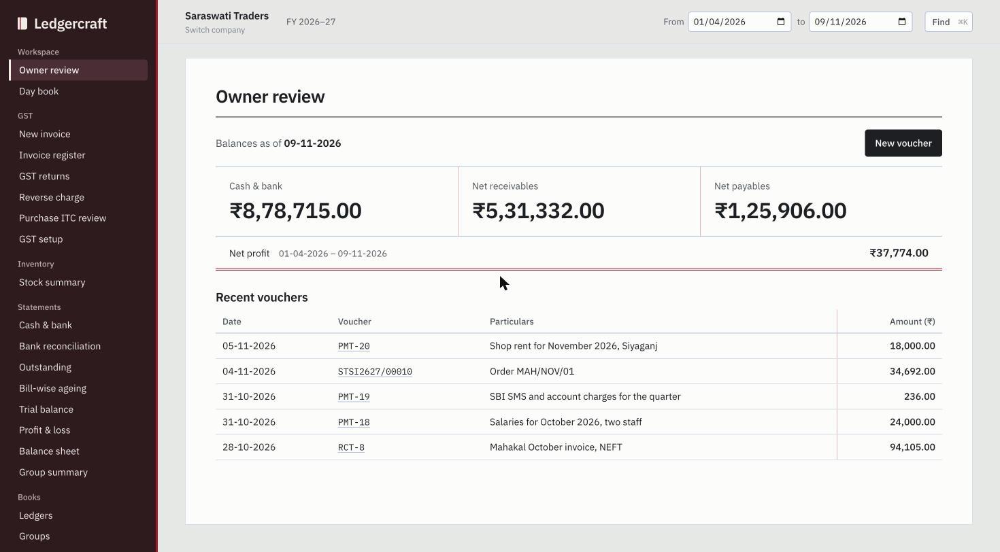
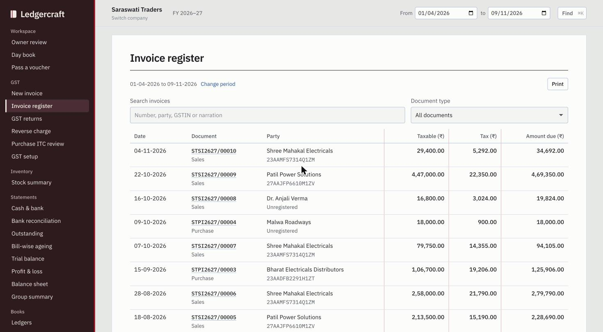
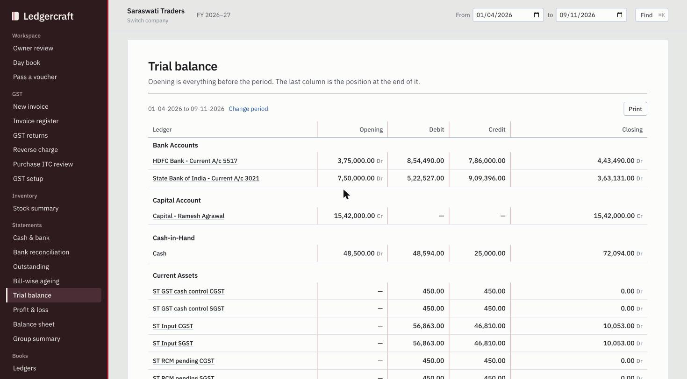
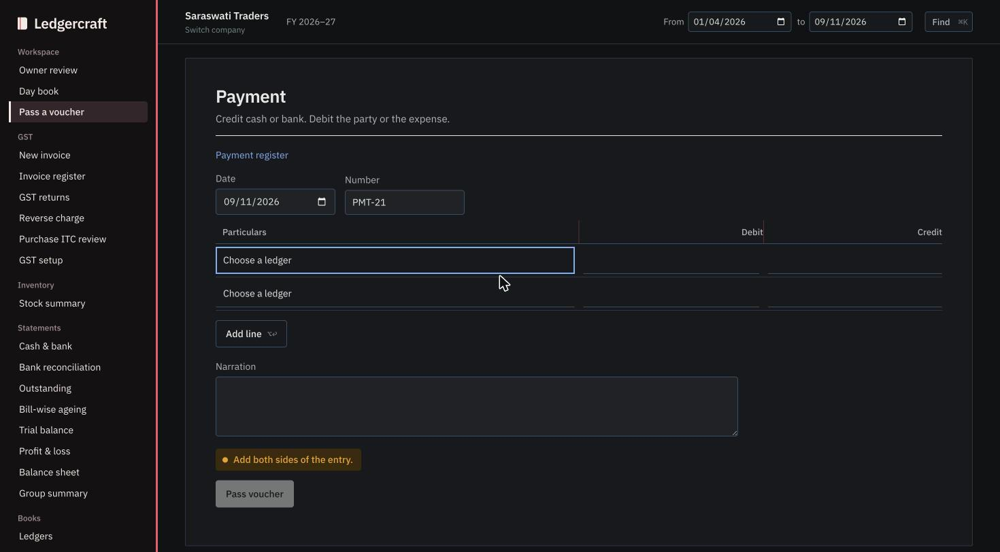

# Ledgercraft

Ledgercraft is a local accounting app for company books, Indian GST billing and Tally data migration. It keeps ledgers, double-entry vouchers, stock movements and supporting source files together. A browser interface and a native macOS wrapper use the same accounting engine.

## Download for Mac

[Download Ledgercraft 1.7.0 for Apple Silicon](https://github.com/gaganmanit/ledgercraft/releases/download/v1.7.0/Ledgercraft-1.7.0-macOS-arm64.dmg). Open the image and drag Ledgercraft.app into your Applications folder. It runs on macOS 13.5 or later. The app is ad hoc signed and has no Apple notarization.

## Get started

Use Node.js 24 or later and Python 3. From the repository root:

```sh
npm run setup
npm start
```

The server prints a start link such as `http://127.0.0.1:4173/?token=…`. Open it once; it sets a cookie so that only your browser, and not other programs on the computer, can use the books. Setup downloads and verifies the GSTN reference resources and the public Tally test fixtures. Book entry and reports work without them; HSN search and the GSTR-1 workbook export need them, and the app says so when they are missing.

A fresh workspace includes a synthetic specimen company. Use the company chooser to create your own books. Set the books-beginning date before entering opening balances. Each company has its own masters and vouchers, and one reporting period that every statement follows.

To see every screen with a lived-in book, seed the demonstration company:

```sh
npm run demo
```

To build the native Mac app:

```sh
bash mac/build.sh
```

The build creates `dist/Ledgercraft.app`. It requires macOS 13 or later and Xcode Command Line Tools, and bundles the selected Node runtime, interface and fonts. See [Mac build instructions](mac/README.md) for installation and verification.

## The interface



Ledgercraft is laid out like a ledger: a dark cover on the left carries the navigation, the white page on the right carries the books, and every money column is framed by a red hairline the way ruled ledger paper frames its amount columns. Totals close with a double red rule. The pages follow your system's light or dark appearance until you choose one with the button at the foot of the cover. The reporting period sits in the top bar and applies to every statement. [docs/DESIGN.md](docs/DESIGN.md) records the design decisions and the shared components.

| Invoice register | Trial balance | Voucher entry, dark pages |
| --- | --- | --- |
|  |  |  |

## Daily books

The company review shows cash and bank, receivables, payables, period profit and recent vouchers, followed by a needs-attention list: the GSTR-1 and GSTR-3B due dates for the latest month with GST documents, receivables more than 30 days overdue, bank statement rows without a match, purchase credit awaiting review and stock items needing review. Each line links to the screen where it is dealt with. Click a balance to open the corresponding statement. The sidebar opens the day book, ledgers, trial balance, profit and loss, balance sheet and group summaries.

Create account groups and ledgers before passing entries. Ledgercraft supports Receipt, Payment, Contra, Journal, Sales, Purchase, Debit Note and Credit Note vouchers. Amounts are stored in paise, and every posted voucher must balance. Opening balances and dated vouchers feed the same reports.

Use ⌘K (Ctrl+K in a browser on other systems) to find a ledger, voucher number, narration or page, and press ? for the list of keyboard shortcuts. Option with C, P, R, J, S, U, D or N opens a Contra, Payment, Receipt, Journal, Sales, Purchase, Debit Note or Credit Note. In voucher entry, type part of a ledger's name or group to pick it from a list that shows each ledger's balance, or create a missing ledger without leaving the voucher. Return moves to the next field, Option+Return adds a line when the voucher balances or fills the missing amount when it does not, and ⌘Return passes a balanced entry. A row with a debit locks its credit field until the debit is cleared, and vice versa. A voucher you leave half-entered is kept as a draft and restored when you return to that voucher type.

Open a saved voucher from the day book to alter, duplicate or print it. Changes that would invalidate the posted books are rejected. Errors appear next to the form they belong to. Every statement has a Download CSV button that writes plain numbers with separate Dr/Cr columns for a spreadsheet, and long day books, ledgers and trial balances load 200 rows at a time while their totals cover every row.

Income and expense ledgers start each financial year at nil. Earlier years' profit appears as one brought-forward row under Capital, and the balance sheet shows retained profit separately from the current year's. Every save is written durably and keeps a backup copy beside the book; a damaged file opens from that copy with a warning.

## Records, locks and numbering

Every change to the books is written to an edit log beside the company's files: who-did-what is recorded as what changed, when, the copy before and after, the request that made it and the reason where one was given. The log is append-only and hash-chained, so a line that is altered or removed shows up as a broken chain. It travels with backups and a restore adds to it rather than replacing it. Open **Edit log** under Books to filter it by period, kind and words. This meets the audit-trail requirement in Rule 3(1) of the Companies (Accounts) Rules 2014.

**Settings** under Books holds the numbering series for each voucher type (prefix, suffix with a `{fy}` token that becomes `26-27`, zero padding and whether numbers restart every financial year) and the period locks. A books lock refuses any voucher, opening balance or stock journal dated on or before the lock date; a GST lock refuses GST documents and return decisions dated on or before it. Both need a reason and are written to the edit log. An opening balance on a ledger that vouchers already use can be corrected by giving a reason.

**Party statements** under Books lists every debtor and creditor with its balance, overdue amount and ageing in current, 1 to 30, 31 to 60, 61 to 90, 91 to 180 and over 180 days, worked out from bill due dates or from the voucher date plus the party's credit days. Open a party for a dated statement with running balance, due dates and open items, printable or downloadable as CSV. Suppliers marked as registered MSMEs show amounts unpaid beyond 45 days of the bill date (Section 43B(h) of the Income-tax Act).

## GST billing and review

Start in **GST setup**. Save the business registration, customer or supplier, and goods or service masters. The local HSN/SAC directory supports code and description search. An item carries its classification, unit and explicit tax rate.

**New invoice** creates itemised sales, purchases and supported linked notes. Registration, place of supply, tax treatment and dated document particulars determine the posting. The invoice register opens the stored document, its print view and associated accounting entry.

**GST returns** provides GSTR-1 and GSTR-3B working figures, HSN summaries, the GSTR-1 Excel workbook and the GSTR-1 JSON file for the GST portal's offline tool or the Returns dashboard upload, with a readiness check that lists warnings before you download. A sales credit note that would reduce tax after the Section 34(2) time limit is refused with the date and a pointer to a financial credit note. Purchases record the supplier's own invoice date, which drives the Section 16(4) deadline and GSTR-2B matching. Import a GSTR-2B file to compare supplier documents with the purchase register. Saved statement originals and reviewed matches stay linked to their source.

**Purchase ITC review** records dated claims, reversals, reclaims and permanent cost decisions against a purchase and its evidence. **Reverse charge** separates liability, cash discharge and credit decisions. **Return corrections** preserves the posted transaction while recording supported corrections to previously reported particulars, including their original filing reference and evidence.

The document exchange screens prepare supported IRP and e-way bill payloads and accept acknowledgement files. Portal submission and filing take place through the relevant external service. Source references, prepared payloads and recorded acknowledgements have separate statuses in Ledgercraft.

## Stock and reconciliation

**Stock summary** opens items, godowns, opening values and stock journals. Record transfers, adjustments or physical counts, and inspect quantities and values by item and location. The stock engine supports perpetual FIFO and moving-average costing.

To include stock values in the financial statements, reconcile opening item values to the Stock-in-Hand ledger controls, then enable **Integrate accounts with inventory**. Selling prices and outgoing inventory costs remain separate.

**Bank reconciliation** maps a local CSV statement to a bank ledger and reviews proposed matches. **Bill-wise ageing** follows supported opening bills, invoice references and partial settlements. Imported Tally bank and bill details are reviewed according to the [compatibility guide](TALLY-COMPATIBILITY.md).

## Import from Tally

Select XML masters and vouchers, native JSON exchange files, a supported TallyPrime default Excel workbook, or its single-workbook ZIP. Review the import before creating a separate company. The preview shows postings, source exceptions, ledger mappings, opening-balance scope and possible overlaps between exports.

For a workbook containing billed quantities without actual quantities, physical stock movement needs an explicit quantity decision. The imported company's **Tally source** area retains original files, spreadsheet cells, source fields and transport references.

**GST from Tally** links supported domestic goods sales and purchases to their original postings and stock movements. For a purchase, select the business registration and supplier’s creditor ledger. Review the supplier invoice number and date, place of supply, actual and billed quantities, HSN, rate and original input-tax accounts. The Tally voucher number and posting date stay in the books.

An activated purchase starts with ITC pending. Match the supplier’s document to GSTR-2B and record a dated decision in **Purchase ITC review**. A purchase entered in April can match its supplier’s March invoice while the ledger continues to show the April entry. An accounting-only purchase remains available in the day book even when the source supplies too little detail to create a GST invoice.

A domestic service invoice can contain several service ledgers. In **GST from Tally**, map each one to its GST service master and review the dated SAC and rate. A mixed invoice also shows the goods and their stock movement. For an accrued purchase you can leave a service pending and record its acceptance date and evidence when claiming its input tax. Goods that already qualify can be reviewed on their own.

For an imported credit or debit note, choose the original invoice and the affected lines. A purchase return entered as a buyer's debit note can be matched to the supplier's credit note in GSTR-2B. A financial adjustment changes values only. A physical return also records the goods movement at its linked cost.

Under **GST returns → Outward credit note review**, select a domestic taxable sales credit note, enter the intended declaration date and record supporting evidence. The review controls whether the note reduces the GSTR-1 and GSTR-3B working figures. Issued documents and accounting entries remain visible in the books.


Read [Tally compatibility](TALLY-COMPATIBILITY.md) before a migration. A native Tally company folder or proprietary backup needs an export from a compatible licensed Tally installation. The included Windows companion performs read-only exports through an open company's local HTTP service.

## Save and restore

Under **Import & export**, download a company backup or select a backup to restore it as a separate company. The importer also accepts `company.json` and `vouchers.json` selected together. The company backup limit is 64 MB.

A backup contains the current books and retained supporting data. Imported Tally companies include their original source files; saved GST statement and filing-source files travel with their associated review history. Original-file downloads reproduce the stored source bytes. Accounting XML exports describe the current accounting book.

The browser runner stores its working data in the gitignored `.ledgercraft/data/` directory by default. Set `LEDGERCRAFT_HOME` to choose a different workspace. Native Mac books and workstation preferences live under `~/Library/Application Support/Ledgercraft`; the File menu opens that location. Keep backups outside the working data directory when you want a separate copy.

## Tests and development

The workbook checks use Python and openpyxl. Prepare an isolated test environment, then run the automated suite:

```sh
python3 -m venv .venv
source .venv/bin/activate
python3 -m pip install -r requirements-test.txt
npm test
```

The suite covers accounting, storage, reconciliation, stock, GST preparation, migration and backup restoration. Tests that need the downloaded GSTN resources or the public Tally fixtures skip, naming the missing file, when `npm run setup` has not been run. A ready-to-enable GitHub Actions workflow at [tools/ci/github-tests.yml](tools/ci/github-tests.yml) runs the suite on macOS and Linux for every push; copy it to `.github/workflows/` from a checkout whose token has the `workflow` scope. Test books are synthetic or come from documented public examples. The fixture READMEs and source manifests describe their origins. Optional integration checks use PowerShell, LibreOffice or macOS WebKit when their prerequisites are available; the core test run does not prove a licensed Tally round trip or portal acceptance.

The project uses JavaScript modules and Node's built-in test runner. The main directories are:

| Directory | Purpose |
| --- | --- |
| `lib/` | Accounting, storage, GST, stock and import/export rules |
| `public/` | Browser interface, local fonts and Windows export companion |
| `mac/` | Native wrapper and app build |
| `test/` | Automated tests and documented fixtures |
| `tools/` | Resource preparation, verification and benchmarks |

Ledgercraft currently runs as a single-machine workspace bound to loopback. Shared-server access controls and coordinated multi-user editing are future work. The [roadmap](ROADMAP.md) records the remaining product scope, the [changelog](CHANGELOG.md) records what changed in each release, [CONTRIBUTING.md](CONTRIBUTING.md) explains how to set up and propose a change, and [SECURITY.md](SECURITY.md) describes what the loopback server does and does not protect.

## License

Ledgercraft's application code is available under the [MIT license](LICENSE). Third-party components, fonts and downloaded reference data retain their own licenses and attribution; see [third-party notices](THIRD-PARTY.md).
